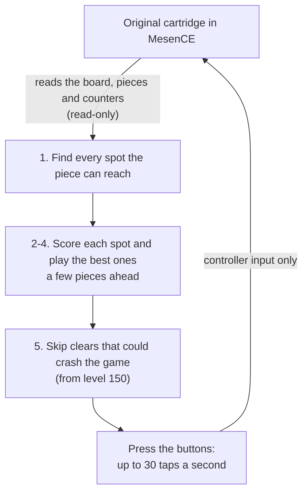

# Oracle

[](LICENSE)


Oracle is a bot that plays Nintendo's original Tetris (USA, NTSC, A-Type) for score, from level 18 to
level 255 and past the level counter's wrap back to 0, with **controller input only**: no ROM,
RAM or random-number edits and no savestates in play. Every result is replayed from its
recorded inputs in a fresh emulator and must match exactly.

## Results

All games verified in MesenCE 2.2.1 (full list: [nes-bot/docs/RESULTS-255.md](nes-bot/docs/RESULTS-255.md)).

| Result | Games | Detail |
|---|---|---|
| **Score per lap (level 18 → 255)** | 9 | Average **101.04M** uncapped points, best 103,426,918. Oracle (current version score-nextbox, 3 games) and the one before it (score-v8, 6 games) both average 101.04M; the current one survives more often. The cartridge's own counter stops at 999,999. |
| Reached level 255 (survival bot) | 20 | 3,290 lines each, 22.1–22.5M uncapped points. |
| Rebirth: 255 → wrap to 0 → 255 again | 1 | Absolute level 511, 6,651 lines, 43,047,996 points. |

Simulator: Oracle survives about 98.5% of laps survived over five-lap games, the target being
five rebirths in a row.

## How Oracle works



1. **Reachable moves only.** From level 29 pieces fall one row per frame. The planner lists
   every placement the piece can reach with legal timed inputs (at most 30 taps a second,
   starting on the frame the piece appears).
2. **A tuned rule sheet.** Each result board is scored on 25 features (holes, bumpiness,
   well depth, Tetris-ready, clear type, reachability). Weights were tuned in a fast simulator.
   Three modes: **Tetris mode** builds a 9-row stack with an open right column (8 rows at
   240-255, 6 at 151-158); **burn mode** clears lines when the stack is above that;
   **safe mode** (the classic Dellacherie survival evaluator) plays levels 168-173, 249, 253
   and 255.
3. **Playouts.** The 12 best (current, next) pairs are each played forward over all 49
   sequences of the two unknown pieces after them, weighted by the NES piece odds. A top-out
   scores −1000.
4. **A learned score guess.** At the end of each playout a small neural network
   (`value-net-v8b.npz`) guesses how many points the board will still earn. It learned this
   from about 730k simulated boards and is used at levels 18-153 and 176-243 while the stack
   is at most 9 rows.
5. **Crash avoidance.** From level 155 a line clear can make the score routine overrun into
   the frame interrupt and crash the CPU. `crash_cycle_model.py` (a port of HydrantDude's
   model as implemented in TetrisGYM) rates every clear. The bot plays the safest surviving
   move, chooses per move whether to hold Down, and presses Select to hide the next-piece box
   when that moves a clear out of the crash window.

Full write-up: [nes-bot/docs/NES-255.md](nes-bot/docs/NES-255.md).

## Quick start

Python 3.13 and a portable [MesenCE 2.2.1](https://github.com/nesdev-org/MesenCE/releases/tag/2.2.1).
The original game image comes with the `gym-tetris` dependency; none is included here.
On Windows, `.\nes-bot\setup.ps1` builds the environment from `nes-bot/requirements.txt`; Linux
cloud machines and the emulator settings are covered in [nes-bot/docs/SETUP.md](nes-bot/docs/SETUP.md).
Point the launcher at them with `MESEN`, `PY` and `JIT_DEPS`:

```bash
sh nes-bot/tools/run-score-nextbox.sh 957        # Oracle, one lap to level 255
sh nes-bot/tools/run-score-nextbox.sh 957 511    # rebirth: on to 255 again
sh nes-bot/tools/run255.sh 19211                 # survival bot
nes-bot\tools\watch.cmd 500                      # watch a recorded game
```

Each game is checked by replaying it in a fresh emulator when it ends. The seed is the
number of frames waited on the menu, which fixes the piece sequence. `watch.cmd` shows
the uncapped score next to the game.
Test changes in the simulator first: `python nes-bot/tools/zone_sim.py --help`
(see [nes-bot/tools/README.md](nes-bot/tools/README.md)).

**Tests**, from the repository root: `python -m pytest -q`. Emulator tests skip when MesenCE
is not available. `nes-bot/tests/test_sim_regression.py` pins the simulator against
`nes-bot/tests/data/sim_golden.json`; after an intended behaviour change, re-record with
`python nes-bot/tools/sim_golden.py --write`.

## Layout

| Path | What it is |
|---|---|
| [`nes-bot/nes_original/`](nes-bot/nes_original/README.md) | The bot: evaluator and simulator (`sim.py`), crash model, controller (`feedback.py`), MesenCE driver, game runner (`endurance.py`, `runner.py`). Weights and value nets in `weights/`. |
| [`nes-bot/nes/`](nes-bot/nes/README.md) | The NES rules engine the bot builds on: piece geometry, gravity, randomizer, legal inputs. |
| [`nes-bot/tools/`](nes-bot/tools/README.md) | Launchers, batch runner, simulator, value-net training, replay viewer. |
| `nes-bot/tests/` | Tests, including the simulator goldens. |
| [`nes-bot/docs/`](nes-bot/docs/) | How it works ([NES-255.md](nes-bot/docs/NES-255.md)), every verified game ([RESULTS-255.md](nes-bot/docs/RESULTS-255.md)), setup ([SETUP.md](nes-bot/docs/SETUP.md)). |

`nes-bot/` is the import root. The launchers and `pytest.ini` set the path; for hand-typed
`python -m ...` commands run `python -m pip install -e .` once, or set `PYTHONPATH=nes-bot`.
Contributions follow [CONTRIBUTING.md](CONTRIBUTING.md).

Earlier bots (a learned DQN for modern-rules Tetris, the Offline Sprint game, NES learning
pilots), old research tools, the development log and old evidence files were removed in
November 2026. They are in git history (commit `6d85b58` and before).

## Limits

- Verified in an emulator (MesenCE 2.2.1), not on NES hardware.
- Survival rates are simulator estimates; verified counts are the games in the results file.
- The crash model's predictions past the first lap are tested by one rebirth game.

## Credits

- **HydrantDude**'s crash research and its implementation in
  [TetrisGYM](https://github.com/kirjavascript/TetrisGYM) (`src/modes/crash.asm`), the basis
  of the crash-timing model.
- [MesenCE](https://github.com/nesdev-org/MesenCE), the reference emulator.
- [CelestialAmber/TetrisNESDisasm](https://github.com/CelestialAmber/TetrisNESDisasm),
  [MeatFighter's NES Tetris analysis](https://meatfighter.com/nintendotetrisai/) and
  [negative-seven's "Tetris explained"](https://negative-seven.github.io/tetris_explained/#high-levels--crashing-the-game)
  for game mechanics and crash behaviour.
- [StackRabbit](https://github.com/GregoryCannon/StackRabbit) for the playout idea and
  [BetaTetris](https://github.com/BetaTetris/betatetris-tablebase) for the next-box idea.
- [nes-py](https://github.com/Kautenja/nes-py) and [gym-tetris](https://github.com/Kautenja/gym-tetris),
  the alternative emulator core and the installed game image.
- Board features follow Dellacherie's classic evaluator.

Tetris is a trademark of The Tetris Company. This is an independent research project, not
affiliated with or endorsed by Nintendo or The Tetris Company.

## License

MIT, see [LICENSE](LICENSE). Dependencies keep their own licenses.
